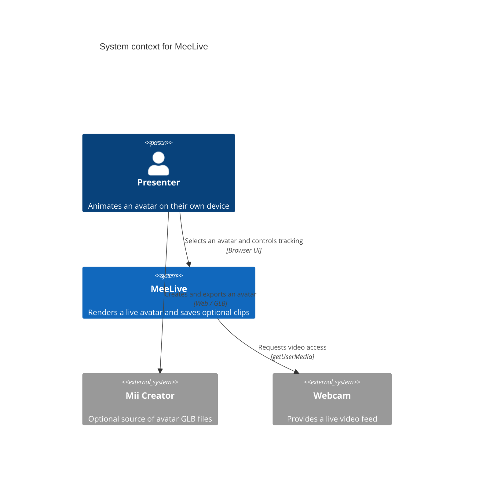
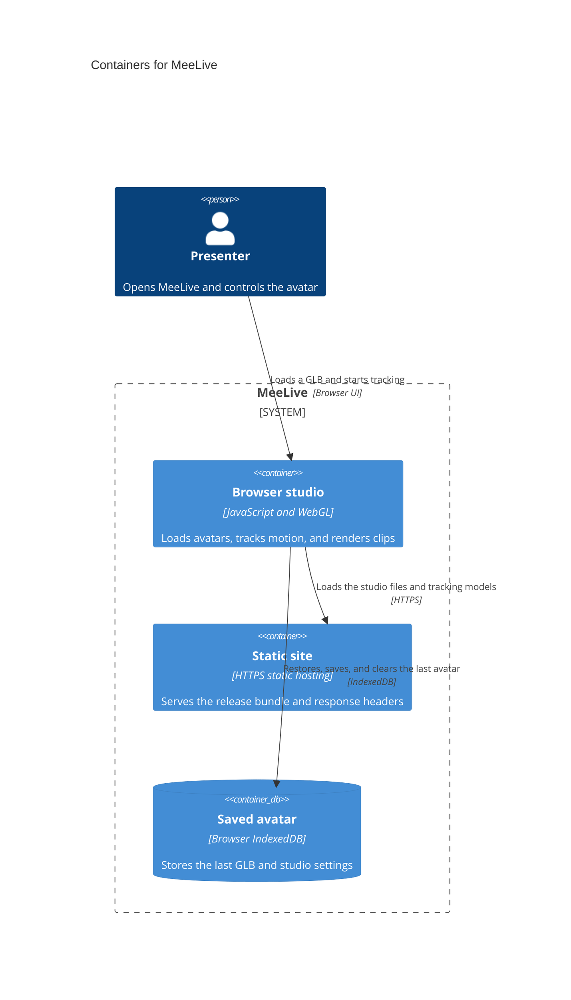
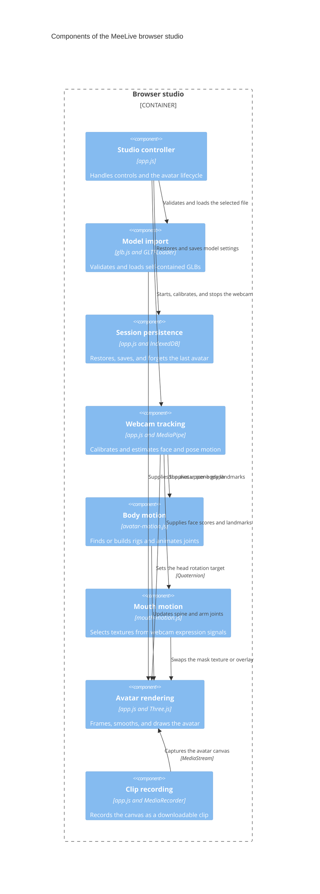
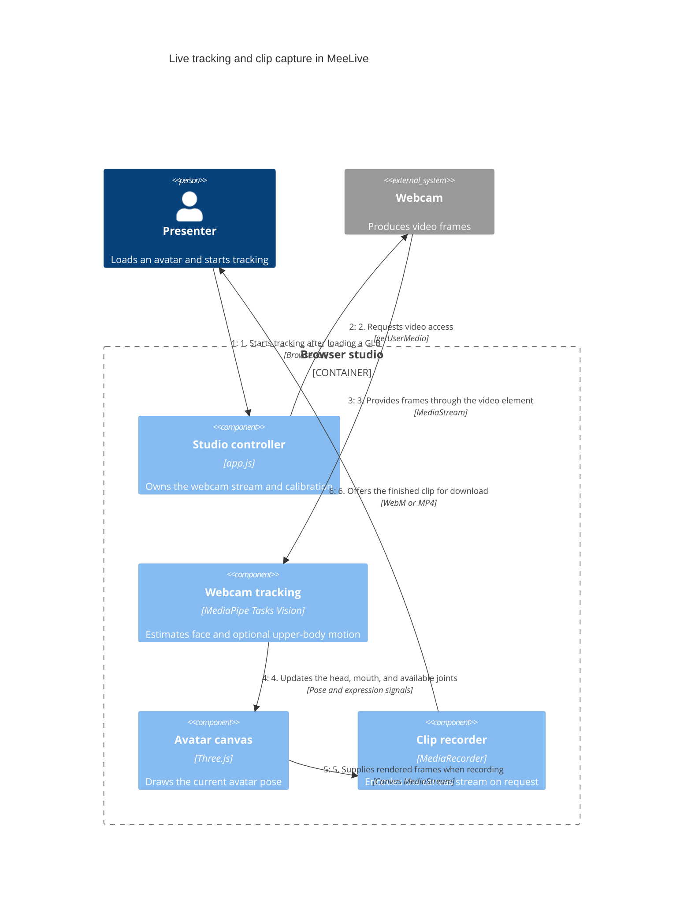
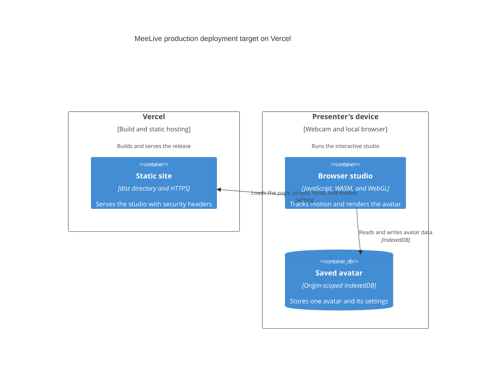

# MeeLive

MeeLive is a browser-based avatar studio that turns webcam motion into a live 3D avatar preview with optional clip recording. Avatar files, motion tracking, and recording stay on your device.

With Node.js 22 or newer, run `npm ci --ignore-scripts` followed by `npm run build` to create `dist/` (see the [usage and deployment guide](docs/usage-and-deployment.md)).

## System context

## Containers

## Browser studio components

## Live tracking flow

## Vercel deployment

