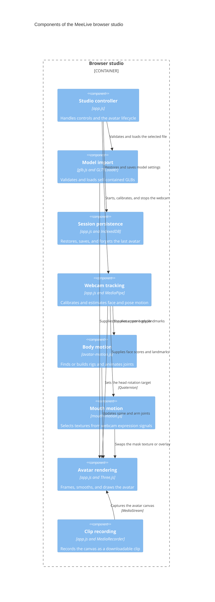

# Browser studio components

| Part | Where to start |
| --- | --- |
| Load an avatar | [`loadModel`](../../app.js#L428) calls [`validateGlb`](../../glb.js#L33) before parsing. It mounts the scene, then selects a saved head node or looks for `Head` or `miiHead`. The node picker supports manual selection. |
| Track and render | [`detectFrame`](../../app.js#L805) samples the webcam. [`animate`](../../app.js#L866) smooths head rotation, applies body motion, and redraws the canvas when needed or while recording. [`frameAvatar`](../../app.js#L354) chooses the Full body fit or the Bust crop. |
| Animate the body | [`avatar-motion.js`](../../avatar-motion.js) maps pose landmarks to supported spine and arm joints. It can generate a torso and arms for compatible head-only Mii exports. |
| Animate the mouth | [`mouth-motion.js`](../../mouth-motion.js) uses blendshape scores and lip landmarks to select a mouth shape. It swaps part of a compatible Mii mask or uses a head-attached overlay. |
| Record a clip | [`startRecording`](../../app.js#L898) feeds the canvas stream to `MediaRecorder`. [`finishRecording`](../../app.js#L956) exposes the result as a local download. |

See [what happens in each live frame](c4-dynamic-live-tracking.md).
