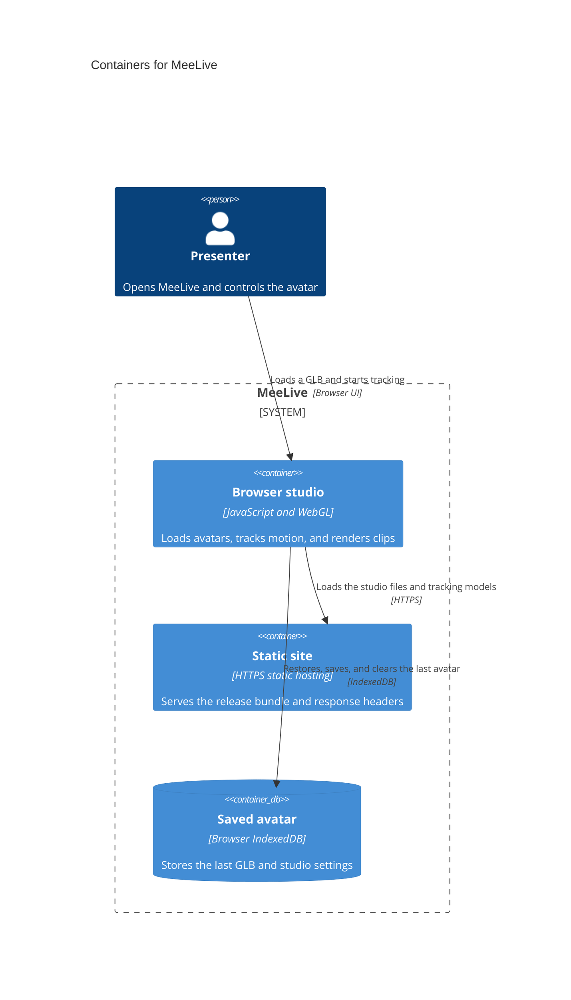

# MeeLive containers

- **Browser studio.** [index.html](../../index.html) defines the interface and the import map. [bootstrap.js](../../bootstrap.js) starts [app.js](../../app.js) and reports startup errors. Three.js, MediaPipe, and their worker and WASM files run on the device as part of the studio.
- **Static site.** [scripts/build.mjs](../../scripts/build.mjs) assembles the app, artwork, fonts, and dependencies in `dist/`. After loading the page, the studio fetches tracking models and other assets from the same origin as needed.
- **Saved avatar.** [app.js](../../app.js#L525) stores the last GLB, head node, front angle, framing, body-tracking setting, and mouth placement in IndexedDB. **Forget saved avatar** removes that copy and keeps the current model open for the visit. Clips are generated in memory and downloaded separately.

See the [browser components](c4-components-studio.md) and the [Vercel deployment](c4-deployment.md).
