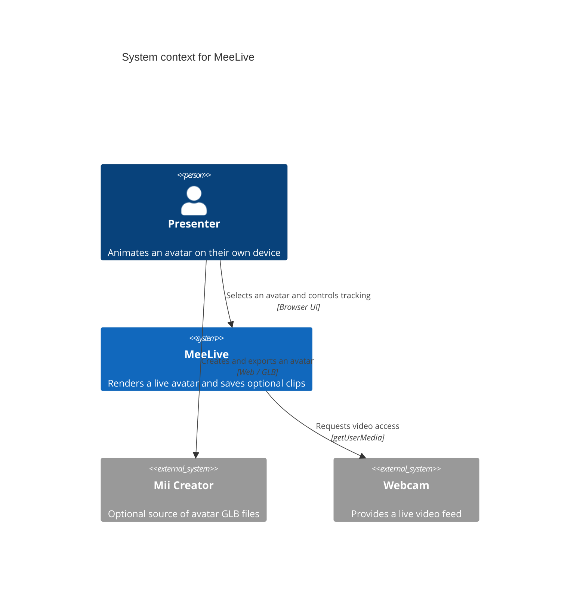

# MeeLive system context

The presenter transfers the GLB from Mii Creator to MeeLive by choosing a local file. MeeLive also accepts compatible GLBs from other sources. Webcam frames, avatar files, and canvas recordings are processed on the presenter's device. A public host delivers the studio files.

Next, see [where the code and data live](c4-containers.md).
