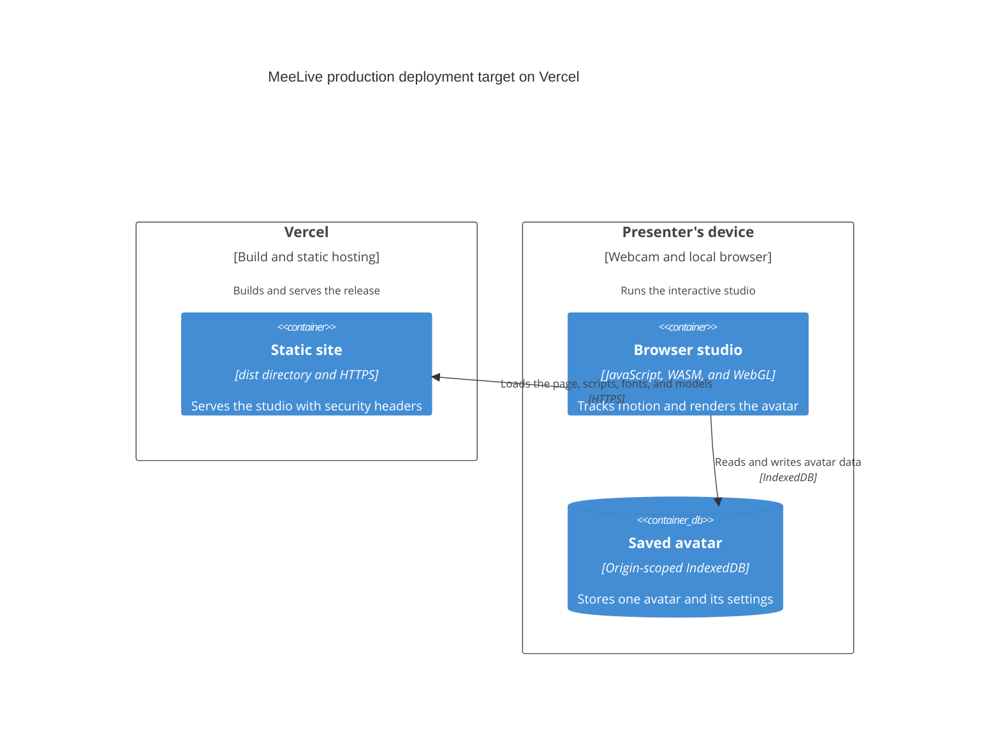

# Vercel deployment

1. Vercel uses [`vercel.json`](../../vercel.json) to install the locked packages, run `npm run build`, and publish `dist/`.
2. [`scripts/build.mjs`](../../scripts/build.mjs) verifies the SHA-256 digests of the pinned MediaPipe models and upstream license. It copies the release files and checks that the import map matches the hash in the Content Security Policy. The same policy is emitted as `dist/_headers` for Cloudflare Pages and local preview.
3. The browser gets the app and its assets over HTTPS. The page asks for camera permission on **Start tracking**. Tracking, IndexedDB storage, and recording run on the presenter’s device.

This diagram shows the repository’s configured deployment target. See [deployment and local preview commands](../../README.md#deploy-publicly).
