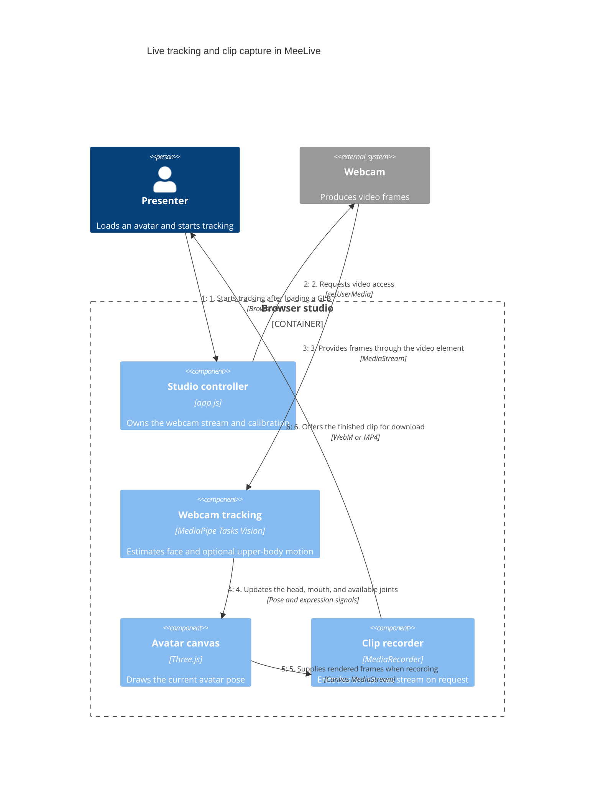

# Live tracking flow

1. **Calibrate.** When the presenter starts tracking, the app averages a steady head pose for roughly a second and samples the resting mouth. A supported, enabled upper-body rig also establishes a reference pose. [Camera startup](../../app.js#L654) · [Neutral pose calibration](../../app.js#L737)
2. **Repeat.** The video callback runs face detection on fresh frames and samples pose less often when body tracking is enabled. The frame loop applies mirrored, neutral-relative head rotation and joint updates. Mouth tracking uses face landmarks and scores to select the texture. [Frame detection](../../app.js#L805) · [Animation loop](../../app.js#L866)
3. **Record on request.** The recording samples the rendered canvas and creates a downloadable clip when stopped. The clip contains the avatar view without webcam imagery or microphone audio. [Canvas capture](../../app.js#L898) · [Clip download](../../app.js#L956)
